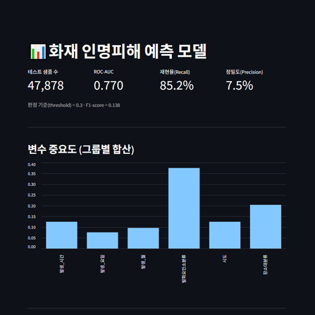
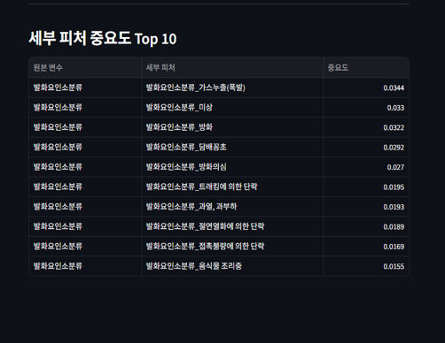

# 화재 인명피해 예측

소방청 화재 발생 정보로 **화재 한 건에서 인명피해가 발생했는지**를 예측하는 분류 모델과, 결과를 보여주는 Streamlit 대시보드입니다. 수업에서 진행한 3인 팀 프로젝트입니다.

| 이름 | 담당 역할 |
| --- | --- |
| 김기완 | 데이터 탐색(EDA), 시각화 스트림릿 코드 작성 |
| 노가희 | 데이터 탐색(EDA), 전처리 및 분석 모델 코드 작성, 변수 중요도 그룹화 로직 구현 |
| 태두혁 | 데이터 탐색(EDA), 분석 방향 설계 및 피드백 |
<p>
  
  
</p>

## 한눈에 보기

| 지표 | 값 |
|---|---|
| 데이터 | 소방청 화재 발생 정보 약 19만 건 (2020~2024) |
| 인명피해 발생 비율 | 약 4.4% (불균형 데이터) |
| 모델 | RandomForest (300 trees, `class_weight='balanced'`) |
| 판정 기준(threshold) | 0.3 |
| **재현율(Recall)** | **85.2%** |
| ROC-AUC | 0.77 |
| 정밀도(Precision) | 7.5% |

## 내가 맡은 부분

- 데이터 탐색(EDA)
- 전처리 및 분석 모델 코드 작성
- 변수 중요도 그룹화 로직 구현

## 문제 정의와 접근

**목표** 화재 발생 정보(지역, 발화요인, 장소, 발생 시각)만으로 인명피해 발생 여부(0/1)를 예측합니다.

**불균형 데이터** 인명피해가 난 화재는 전체의 약 4.4%뿐이라, 모두 "피해 없음"으로 찍어도 정확도가 95%를 넘습니다. 그래서 정확도 대신 **놓치는 사례를 줄이는 재현율**을 기준으로 삼았습니다.

- `class_weight='balanced'`로 소수 클래스에 가중치를 줍니다.
- 판정 기준을 기본값 0.5가 아닌 **0.3**으로 낮춰 피해 사례를 더 많이 잡습니다.

**전처리** (`fire.ipynb`)
- `인명피해(명)소계`가 1 이상이면 1, 아니면 0으로 정답 컬럼(`인명피해_발생여부`)을 만들었습니다.
- 화재 발생 일시에서 월, 시간, 요일을 뽑아 파생 변수로 사용했습니다.
- 결과에 해당하는 컬럼(인명피해, 사망, 부상, 재산피해)은 입력에서 제외했습니다.
- 모델 입력 변수 6개: 시도, 발화요인소분류, 장소대분류, 발생_월, 발생_시간, 발생_요일

**모델** (`train.py`)
- 범주형: 최빈값 대체 → 원-핫 인코딩 / 수치형: 중앙값 대체 → 표준화를 `Pipeline`으로 묶었습니다.
- 학습·테스트를 75:25로 나누고, 정답 비율이 같도록 층화 추출(`stratify`)했습니다.

## 결과

테스트 47,878건 기준 혼동행렬입니다.

| | 예측: 피해 없음 | 예측: 피해 있음 |
|---|---:|---:|
| **실제: 피해 없음** | 23,459 | 22,290 |
| **실제: 피해 있음** | 316 | 1,813 |

- 실제 인명피해 2,129건 중 **1,813건을 잡아냈습니다(재현율 85.2%)**.
- 대가로 "피해 있음"으로 예측한 건의 7.5%만 실제 피해였습니다(정밀도 7.5%). 즉 **오탐이 많은 모델**입니다. 놓치지 않는 것이 더 중요한 경고·우선 점검용으로 쓴다는 가정에서 이 균형을 택했습니다.

### 변수 중요도 (그룹별 합산)

원-핫 인코딩을 하면 범주형 변수 하나가 `발화요인소분류_방화`, `발화요인소분류_담배꽁초`처럼 수십 개 컬럼으로 쪼개져서, 개별 중요도는 작게 보이는 착시가 생깁니다. 그래서 **원-핫 컬럼을 원래 변수 단위로 합산**해 비교했습니다.

| 변수 | 중요도 |
|---|---:|
| 발화요인소분류 | 37.5% |
| 장소대분류 | 20.4% |
| 시도 | 12.5% |
| 발생_시간 | 12.5% |
| 발생_월 | 9.6% |
| 발생_요일 | 7.6% |

세부 항목 중에서는 `가스누출(폭발)`, `방화`, `담배꽁초` 같은 발화요인이 상위에 올랐습니다.

### 한계

- 입력 변수가 6개뿐이고 ROC-AUC가 0.77이라, 예측력이 높은 모델은 아닙니다.
- 정밀도가 낮아 실제 운영에 쓰려면 기준값과 비용 관점의 추가 검토가 필요합니다.

## 프로젝트 구조

```
fire_v2/
├─ fire.ipynb          # EDA, 전처리 (fire.csv 생성)
├─ train.py            # 모델 학습, 평가, 변수 중요도 그룹화 → metrics.json
├─ fire_streamlit.py   # 결과 대시보드
└─ metrics.json        # 학습 결과 요약 (대시보드가 읽음)
```

## 실행 방법

원본 데이터와 `fire.csv`는 용량이 커서 저장소에 올리지 않았습니다. 공공데이터포털의 **소방청 화재 발생 정보** 파일(`소방청_화재발생 정보_20241231.csv`)을 받아 같은 폴더에 두세요.

```bash
cd fire_v2
pip install pandas scikit-learn joblib streamlit

# 1. fire.ipynb를 위에서부터 실행 → fire.csv 생성
# 2. 모델 학습 (metrics.json, casualty_model.joblib 생성)
python train.py

# 3. 대시보드 실행
streamlit run fire_streamlit.py
```

## 사용 기술

Python · pandas · scikit-learn · Streamlit · Jupyter
